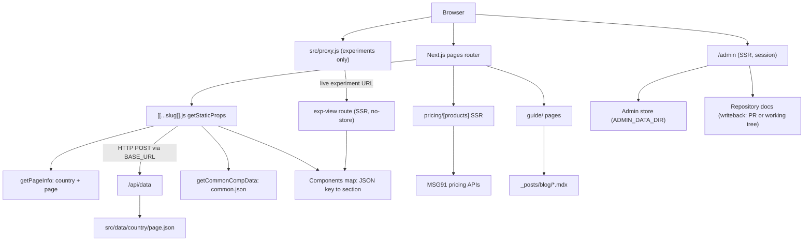
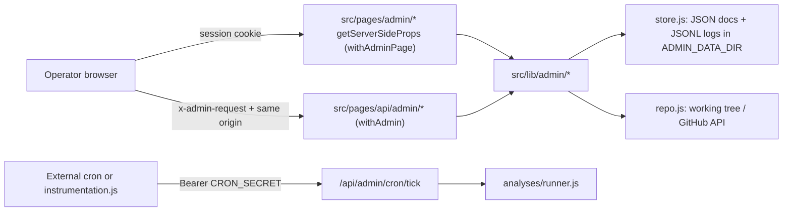
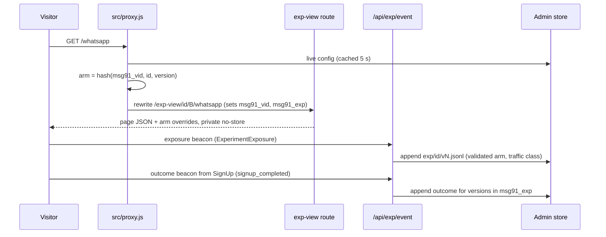

# Architecture & Mental Model

msg91.com is a Next.js 16 **pages-router** site in plain JavaScript. Almost every marketing page is **data, not code**: one optional catch-all route reads a JSON file from `src/data/` and renders that file's top-level keys, in order, through a component registry. A few routes run their own code: pricing (SSR against MSG91 pricing APIs), the MDX guide/blog, and small OAuth/verification callback pages. There is no global client store and no auth session. The site's job is to send visitors to MSG91 sign-up and login. Env vars and commands are in [DEVELOPMENT.md](DEVELOPMENT.md). Internal API request/response shapes, cookies and storage keys are in [CONTRACTS.md](CONTRACTS.md).

## System Overview & Mental Model

**Mental model:** URL → `pageInfo` (`country`, `page`, `pathURL`, `baseURL`) → JSON document → ordered list of `{ registryKey: sectionData }` → React sections, with the notification bar, menu and footer always wrapped around them. To change what a page shows, edit JSON. To add a new _kind_ of section, add a component and register it.

## Entry Points & Bootstrap Sequence

1. **Entry File:** `src/pages/_app.js:App`. Pages-router root. `src/pages/_document.js:MyDocument` renders the HTML shell.
2. **Bootstrap Steps:**
    - Step 1: `next.config.mjs` loads a local .env file through `dotenv` and copies a fixed list of variables into the `env` block, which inlines them at build time. The same file adds security headers (HSTS, `X-Frame-Options: DENY`, COOP `same-origin-allow-popups` for the Google OAuth popup) and allows `placehold.co` images. `jsconfig.json` maps the `@/` import alias to `src/`.
    - Step 2: `src/pages/_document.js:getLanguageFromPath` sets `<html lang>` from the first URL segment through `src/data/availableCountries.json` (`htmlLang`, default `en`). It also hard-codes `data-theme='light'` (DaisyUI). No scripts are injected here.
    - Step 3: `src/pages/_app.js:App` imports `src/styles/globals.scss` and the react-toastify CSS. It calls `src/utils/setCookies.js:handleBrawserCookies` as a hook on every page, then renders `src/components/SummitBanner/SummitBanner.js:SummitBanner`, the page, and one global `ToastContainer`.
    - Step 4: The route's data function runs. That is `getStaticProps`, `getServerSideProps`, or nothing for the static callback pages (see [Route map](#route-map)).
    - Step 5: Per-page `<head>` content, third-party scripts (GTM, Microsoft Clarity, the Hello chat widget, JSON-LD for `in`), hreflang and `noindex` on non-production hosts all come from `src/components/HeadComp/HeadComp.js:HeadComp`, rendered as the `HeadComp` key of each page JSON. `src/pages/404.js` repeats these scripts inline. Script and SEO details are in [DESIGN.md](DESIGN.md).

`_app.js` details:

- `handleBrawserCookies` stores the landing query string, or a synthetic `utm_campaign=tigerplugin` string on `/partners-and-integrations/<plugin>`, as the `msg91_query` cookie for 30 days. Then `src/utils/utilis.js:setUtm` appends those UTM params to every `a.utm` link. It runs once, on first mount (`useEffect` with `[]`).
- `SummitBanner` is a geo-gated (Indore, India) countdown for a 2026-09-05 event. `EVENT_EXPIRY_TIME` has passed, so it renders `null` unless `?preview_banner=true` or `?indore=true` is in the URL.
- `ToastContainer` is the only app-wide UI service. Components call `toast()` from `react-toastify` directly.

## Route Map

| URL                                                                | File                                                            | Rendering                                                           | Data source                                                                                                                 |
| ------------------------------------------------------------------ | --------------------------------------------------------------- | ------------------------------------------------------------------- | --------------------------------------------------------------------------------------------------------------------------- |
| `/`, `/<page>`, `/<cc>`, `/<cc>/<page>[/…]` <!-- verify:ignore --> | `src/pages/[[...slug]].js`                                      | SSG on demand: `paths: []`, `fallback: 'blocking'`, no `revalidate` | JSON from `src/data/` through `/api/data`                                                                                   |
| `/pricing/<product>` <!-- verify:ignore -->                        | `src/pages/pricing/[products].js`                               | SSR (`getServerSideProps`)                                          | Pricing APIs (country hard-coded `'us'`) + `src/data/global/pricing.json`                                                   |
| `/<cc>/pricing/<product>` <!-- verify:ignore -->                   | `src/pages/[country]/pricing/[products].js`                     | SSR                                                                 | Pricing APIs + `src/data/<cc>/pricing.json` <!-- verify:ignore -->                                                          |
| `/guide?page=N` <!-- verify:ignore -->                             | `src/pages/guide/index.js`                                      | SSR, 18 posts per page                                              | `src/components/Guide/lib/posts.js:listPostContent`                                                                         |
| `/guide/<slug>` <!-- verify:ignore -->                             | `src/pages/guide/[slug].js`                                     | SSG at build time, `fallback: false`                                | `_posts/blog/*.mdx` via `next-mdx-remote`                                                                                   |
| `/demochatbot?page=N` <!-- verify:ignore -->                       | `src/pages/demochatbot.js`                                      | SSR                                                                 | `src/utils/getBotTemplates.js` (Hello API); menu/footer data is **inlined in the page**, not from `common.json`             |
| `/verify`                                                          | `src/pages/verify.js`                                           | Static, client-only                                                 | Loads the proxy-auth script from `proxy.msg91.com` (Chrome voice extension login)                                           |
| `/github-auth-token`, `/outlook-token`                             | `src/pages/github-auth-token.js`, `src/pages/outlook-token.js`  | Static, client-only                                                 | Read the OAuth query and forward it to `REDIRECT_URL` `/signin` or `/signup`                                                |
| `/admin`, `/admin/*`                                               | `src/pages/admin/`                                              | SSR, session required (`withAdminPage`)                             | Admin store + repository ([Private admin](#private-admin))                                                                  |
| Any experiment URL (rewritten, public URL unchanged)               | `src/proxy.js` → `src/pages/exp-view/[id]/[arm]/[[...slug]].js` | SSR, `private, no-store`                                            | Same JSON as the catch-all + the arm's overrides ([Experimentation](#experimentation)). Direct `/exp-view` requests get 404 |
| 404                                                                | `src/pages/404.js`                                              | Static                                                              | `src/components/NotFoundComp/`                                                                                              |
| `/api/*`                                                           | `src/pages/api/`                                                | Serverless handlers                                                 | Request/response shapes: [CONTRACTS.md](CONTRACTS.md)                                                                       |

Next.js matches named files and dynamic segments before the optional catch-all. A dedicated file therefore always wins over JSON: `src/pages/demochatbot.js` serves `/demochatbot` even though `demochatbot` is listed in `src/data/specialPages.json`. Host-level redirects live in `public/_redirects` (≈1,360 lines, e.g. `/pricing → /pricing/hello`, `/blog → /guide`). Next.js does not process that file.

## JSON-Driven Page Composition

The pipeline is split across three files so the catch-all route and the experiment route render identically: `src/pages/[[...slug]].js` (routing: `getStaticPaths`/`getStaticProps`), `src/utils/loadPageProps.js:loadPageProps` (steps 1–5, server-only) and `src/components/PageRenderer/PageRenderer.js` (step 6) with the registry in `src/components/PageRenderer/sectionRegistry.js`.

1. `getStaticProps` → `loadPageProps(slug)` → `src/utils/getPageInfo.js:getPageInfo(params)`. If the first slug segment, lowercased, matches a `shortname` in `src/data/availableCountries.json`, it becomes `country` and the second segment becomes `page`. Otherwise `country = 'global'` and `page` is the first segment, or `'home'` for `/`. `pathURL` is the full slug joined by `/`. `baseURL` is the slug without its country prefix, used for hreflang/canonical.
2. `src/utils/getCommonCompData.js:getCommonCompData(country)` `require`s `src/data/<country>/common.json` <!-- verify:ignore -->. Its keys are `common`, `notification`, `menu` and `footer`.
3. `loadPageProps` sends `pageInfo` as an HTTP `POST` to `${BASE_URL}/api/data`. `src/pages/api/data.js:handler` resolves the file with the table below.
4. If the response has a `NotFoundComp` key → `{ notFound: true }`, which renders `src/pages/404.js`.
5. **Hello-BR pricing hydration:** when `page === 'hello'`, `country` is `br` or `br-pt`, and the JSON has a `Pricing` key, `src/utils/pricing/getPricing.js` fetches plans and merges `initialPricingData` plus `initialCurrency: 'USD'` into `data.Pricing`. A failure is logged and the page renders without the plans.
6. `PageRenderer` renders `NotificationBarComp` (from `commonData.notification`) and `MenuBarComp` (`commonData.menu`). Then, for each `key` of `data` in insertion order, it renders `resolveSection(key, pageInfo)` (the registry entry, with the Hello-BR overrides) with props `data`, `pageInfo` and `browserPathCase`. `FooterComp` (`commonData.footer`) comes last.

**File resolution in `src/pages/api/data.js:handler`:**

| `pageInfo`                                                 | JSON loaded                                                                                                                                                     |
| ---------------------------------------------------------- | --------------------------------------------------------------------------------------------------------------------------------------------------------------- |
| `page === 'pricing'` (any country)                         | `src/data/<country>/pricing.json` <!-- verify:ignore -->                                                                                                        |
| `country === 'global'`, `page === 'home'`                  | `src/data/global/home.json`                                                                                                                                     |
| `country === 'global'`, other                              | `src/data/global/<pathURL>.json`. Example: `/whatsapp/compare/msg91-vs-twilio` → `src/data/global/whatsapp/compare/msg91-vs-twilio.json` <!-- verify:ignore --> |
| country `cc`, `page === 'home'`                            | `src/data/<cc>/home.json` <!-- verify:ignore -->                                                                                                                |
| country `cc`, other                                        | `src/data/<pathURL>.json` (pathURL already starts with `cc/`) <!-- verify:ignore -->                                                                            |
| file missing, or JSON has a `common` key, or `show: false` | `src/data/notfound.json`, which leads to a 404                                                                                                                  |

**Registry rules (`Components` object in `src/components/PageRenderer/sectionRegistry.js`):**

- Registry key = JSON key, case-sensitive. One component can be registered under several keys. Examples: `IndustryFeatureComp: FeatureComp`, `FeatureBulletGroup: FeatureWithBulletGroup`, and `Features: IntegrationFeatures` (the `src/components/IntegrationComp/` features section). Aliases let content authors use descriptive keys without new code.
- A key can appear only once per JSON object, so a page cannot repeat a section type under the same key. Register an alias to reuse a component twice on one page.
- **Hello-BR overrides:** in `sectionRegistry.js:resolveSection`, key `Banner` is replaced with `src/components/HelloBrComp/BannerComp/Banner.js` and key `Features` with `src/components/HelloBrComp/FeaturesComp/Features.js`. This only happens when `pageInfo.page === 'hello'` and `country` is `br` or `br-pt`. Everywhere else `Banner` is `src/components/UpdatedComp/Banner.js` and `Features` is the IntegrationComp features section.
- Registered but used by no JSON: `NotFoundComp` (it only acts as the 404 sentinel), plus `Testimonials` and `IndustryFeatureComp`, which are kept on purpose (see [OPEN_QUESTIONS.md](OPEN_QUESTIONS.md)). Entries no JSON used on `main` or `web` were removed in the 2026-10-22 cleanup. Run `node scripts/check-page-data.mjs` after changing the registry or any page JSON.

> [!WARNING]
> **Unknown keys fail silently.** A JSON key that is not in `Components` logs `Component "<key>" is undefined…` with `console.error` and renders nothing. The build does not fail. Twelve JSON files already contain a non-component key `moreFeature` (e.g. `src/data/in/hello.json`, `src/data/us/knowledgebase.json`) and log this error on every render. Spell keys exactly as registered.

> [!WARNING]
> **`getStaticProps` calls its own server over HTTP.** The catch-all page `fetch`es `${process.env.BASE_URL}/api/data` instead of reading the JSON directly. `BASE_URL` must point to a **running, reachable instance of this same build** whenever a page is generated. With `paths: []`, generation happens on the first request after each deploy, not at build time. If `BASE_URL` is unset or points to another deployment, every catch-all page returns 500, or returns that other deployment's content. In production the server makes this request to its own public URL.

> [!WARNING]
> **No `revalidate`.** Once a catch-all page has been generated it is served from cache until the next deploy. JSON in `src/data/` is bundled through `require`, so content edits only take effect after a deploy.

## Special and Nested Pages

`src/data/specialPages.json` is a **classification list consumed by link-building and SEO code. It is not a router.** Adding a slug to it creates no page, and removing one deletes no page.

| List                    | Consumers                                                                                                 | Effect                                                                                                            |
| ----------------------- | --------------------------------------------------------------------------------------------------------- | ----------------------------------------------------------------------------------------------------------------- |
| `global` (26 slugs)     | `src/components/notificationBarComp/notificationBarComp.js`, `src/components/HeadComp/HreflangTagComp.js` | Global-only pages: hides the country switcher and emits no per-country hreflang alternates                        |
| `products`, `countries` | `src/utils/getURL.js:getURL`                                                                              | Detects the current country/product in `router.asPath` to rebuild links when the user switches country or product |
| `pricing`               | `src/utils/pricing/getPricingURL.js:getPricingURL`, `HreflangTagComp`                                     | Which products have a pricing page. Menu/footer "Pricing" links fall back to `/pricing/hello`                     |
| `justNested`            | `HreflangTagComp`                                                                                         | Nested global paths (e.g. `partners-and-integrations/tally`, `whatsapp/compare/*`) that get no country hreflang   |

Nested pages are subfolders of a country folder (`src/data/global/whatsapp/compare/`, `src/data/global/partners-and-integrations/`, `src/data/<cc>/otp/`, …) <!-- verify:ignore -->. `/api/data` resolves them through `pathURL`. Footer links marked `nested: true` in `common.json` go through `src/utils/getNestedURL.js:getNestedURL`, which prefixes `BASE_URL` and the country. All other links go through `getURL`. `src/pages/api/getNestedData.js` resolves the same way as `/api/data`, but nothing in the repo calls it.

## Country Localization

- **Supported prefixes:** `src/data/availableCountries.json` has 10 entries: `in`, `br`, `br-pt`, `ae`, `ph`, `fil-ph`, `sg`, `es`, `gb`, `us`. A URL with no prefix is `global`. Language variants (`br-pt`, `fil-ph`) are separate "countries" with their own folders. The `languages` array on an entry drives the language dropdown, and `hide: true` removes an entry from the country dropdown.
- **One folder per country, no fallback:** each of `src/data/<cc>/` <!-- verify:ignore --> holds a full copy of the pages it serves (26 files each, 54 for `global`). If `src/data/in/<page>.json` is missing, `/in/<page>` returns 404 <!-- verify:ignore -->. The site never falls back to the global copy.
- **Pricing country details:** `src/utils/getCurrentCountry.js:GetCountryDetails` looks up currency and dial data in `src/data/countries.json`. It maps `br-pt → br` and `fil-ph → ph`, and `global` to `US`. `src/utils/pricing/getCurrencySymbol.js` uses the same file.
- **`country` cookie:** `PageRenderer` writes `country=<pageInfo.country>` during render when the cookie is absent. `NotificationBarComp` overwrites it when the user picks a country. Both set `max-age=3600` (1 hour). **Nothing in this repo reads it.** No proxy rule or redirect uses it (`src/proxy.js` only routes experiments).

## Pricing Pages

- `src/pages/pricing/[products].js` (global) and `src/pages/[country]/pricing/[products].js` are near-duplicates. They differ only in how they pick the country. Change both together.
- The product decides the fetcher: `voice` uses `src/utils/pricing/getVoicePricing.js`, `sms` and `otp` use `src/utils/pricing/getSmsOtpPricing.js`, and everything else uses `src/utils/pricing/getPricing.js`. `getPricing` maps the slug to a subscription `ms_id` through `msIds` (`hello`, `segmento`, `email`, `rcs`, `whatsapp`, `otpwidget`).
- The route returns 404 when the fetch returned nothing **or** the slug is not listed in the country's `pricing.json` `products.applications` / `products.channels` / `products.services` (field `slug`). Per-product page copy comes from `pricing.json` `pageData[product]`.
- The global route fetches prices and loads `common.json` for country `'us'`, but passes `pageInfo.country = 'global'` to components.
- The UI is `src/components/PricingComp/`. Plan shaping, currency and formatting live in `src/utils/pricing/` (`handlePlanStructure.js`, `formatPrice.js`, `normalizeDialPlanInfo.js`).

> [!NOTE]
> `src/pages/[country]/pricing/[products].js` returns 404 for a country prefix that is not in `src/data/availableCountries.json` (fixed 2026-10-24; it used to `require` a missing `common.json` and return 500). A new country folder still needs a `common.json`, or every page in it fails.

> [!WARNING]
> A bare `/pricing` or `/<cc>/pricing` URL reaches the catch-all, which loads `pricing.json`. That file's keys (`products`, `pageData`) are not components, so the page renders only menu and footer and logs errors. `public/_redirects` sends `/pricing` to `/pricing/hello`. No redirect for the country-prefixed form was found.

## Guide / Blog (MDX)

- Posts are `_posts/blog/*.mdx` (≈280). `src/components/Guide/lib/posts.js:fetchPostContent` reads them with `fs` and `gray-matter` (YAML in `JSON_SCHEMA` mode), caches them in module memory, and sorts by `date`, newest first. Slug = filename up to the **first** `.`.
- `src/pages/guide/[slug].js` pre-builds every post (`fallback: false`), so a new post needs a rebuild and redeploy. It serializes the post with `next-mdx-remote` and makes `ReactPlayer` (client-only `dynamic` import) available inside MDX.
- `src/pages/guide/index.js` is SSR with `?page=` pagination. `src/utils/getGuidePageInfo.js` always returns `country: 'global'`. Both guide routes use global `common.json`. Tags come from `src/data/tags/tags.json` through `src/components/Guide/lib/tags.js`.

## Private Admin

A protected management area inside this app (no separate admin product existed). Server-only code lives in `src/lib/admin/`; pages in `src/pages/admin/`; APIs in `src/pages/api/admin/`.

- **Auth (`src/lib/admin/auth.js`):** operators come from `ADMIN_USERS` (`email|role|scrypt hash`); sessions are HMAC-signed HttpOnly cookies (`msg91_admin`, 8 h, `SameSite=Strict`) keyed by `ADMIN_SESSION_SECRET`. Roles: `viewer` (read), `editor` (drafts, watchlist, analyses, experiment drafts, pause/rollback), `owner` (launch, promote, stop, retire, settings). Every page and API checks the role server-side; non-GET calls also need `x-admin-request: 1` from the same origin. Unconfigured servers answer 503 and show "not configured". Signing in sets `msg91_internal=1` so that browser's traffic is excluded from experiment results.
- **Store (`src/lib/admin/store.js`):** durable JSON documents and append-only JSONL logs under `ADMIN_DATA_DIR` (default `.admin-data/`, git-ignored), with a per-document lock (in-process queue + lock directory) and atomic rename. It needs a persistent disk shared by all server instances (Q-019).
- **Knowledge (`src/lib/admin/knowledge/`, `repo.js`):** the repository is the only source of truth. The admin reads the effective revision (working tree, or `GITHUB_WRITEBACK_BASE` via the GitHub API) and stores **proposed changes** (draft → pending → effective; or conflict / sync_failed / rejected / superseded / discarded). Submitting checks the base blob SHA (conflict detection), then writes the working tree (`local` mode) or opens a branch + PR (`github` mode). History and restore come from git. Writeback is `off` by default in production.
- **Research (`research.js`):** editable watchlist (seeded once from `docs/research/watchlist.seed.json`), change monitoring of official source pages by text fingerprint, and operator findings (observation / interpretation / recommendation).
- **Analyses (`analyses/`):** definitions with deterministic checks (`src/lib/checks/siteContent.js` is shared with scripts), durable run records with dedupe keys, retries with backoff, daily budgets, pause switches, input-revision reuse, and optional AI interpretation (`ai.js`, Anthropic SDK, off unless `ANTHROPIC_API_KEY` and Settings allow it).
- **Settings (`settings.js`) and audit (`audit.js`):** overrides on top of defaults; every change is audited with the previous value.

## Experimentation

- **Registry and lifecycle:** `src/lib/admin/experiments/service.js` owns experiments, versions, slot limits, the checklist, decisions and the compiled live config (`experiments-live`). `src/lib/experiments/live.js` is the read side used on the request path.
- **Assignment:** `src/lib/experiments/assignment.js` (shared by proxy, route and event API). Treatments are section overrides (`merge` / `replace` / `remove`) applied by `applyOverrides`.
- **Events:** `src/lib/experiments/events.js` validates and classifies, appends to per-version logs, and aggregates unique visitors and attributed conversions. Outcome hooks: `src/utils/experimentEvents.js:trackExperimentOutcome`, called from `src/components/signupComp/SignUp.js`.
- **Evaluation:** `src/lib/experiments/stats.js` (fixed-horizon z-tests, Bonferroni, Haybittle–Peto interim boundary, SRM). Policy in [EXPERIMENTS.md](EXPERIMENTS.md).
- **Validation:** `src/lib/admin/experiments/validate.js` sends synthetic events through the real endpoint and checks they are recorded as `synthetic`.
- With no live experiment the proxy returns `NextResponse.next()` after one map lookup, and pages keep their SSG caching.

## Major Modules & Responsibilities

| Module / Layer       | Path                                                                               | Core Responsibility                                                                                                                | Sources of Truth                                                 | May Depend On                                            | Must NOT Depend On                                                                             |
| -------------------- | ---------------------------------------------------------------------------------- | ---------------------------------------------------------------------------------------------------------------------------------- | ---------------------------------------------------------------- | -------------------------------------------------------- | ---------------------------------------------------------------------------------------------- |
| Routing / Pages      | `src/pages/`                                                                       | Route resolution, data functions (`getStaticProps`/`getServerSideProps`), page shell (notification bar + menu + sections + footer) | URL path and query                                               | `src/components/`, `src/utils/`, `src/data/`             | Importing `src/pages/api/*` handlers directly (call them over HTTP)                            |
| Internal API         | `src/pages/api/`                                                                   | JSON page lookup, pricing proxies, Apple Messages link, cURL conversion, summit WhatsApp send                                      | Request body, `src/data/`, env                                   | `src/utils/`, `src/data/`                                | Components                                                                                     |
| Page content         | `src/data/`                                                                        | Every catch-all page, per-country menu/footer, pricing catalog, country lists                                                      | The JSON files themselves                                        | —                                                        | —                                                                                              |
| Components           | `src/components/`                                                                  | Sections rendered by registry key, plus shared chrome (menu, footer, head)                                                         | Props (`data`, `pageInfo`) and imported JSON                     | `src/utils/`, `src/data/`, other components              | `src/pages/`                                                                                   |
| Application State    | Local component state, cookies, URL                                                | UI toggles, forms, pricing selectors                                                                                               | `useState` / class state, `document.cookie`, `router.asPath`     | `src/utils/utilis.js` cookie helpers                     | A shared store (none exists; don't add one without a decision in [DECISIONS.md](DECISIONS.md)) |
| Server / Remote Data | `src/utils/pricing/`, `src/utils/getBotTemplates.js`, inline `fetch` in components | Calls to MSG91 pricing, voice, subscription and Hello APIs                                                                         | Remote APIs ([CONTRACTS.md](CONTRACTS.md))                       | `axios`, `src/data/countries.json`                       | Components                                                                                     |
| Business Logic       | `src/utils/`                                                                       | Country/page resolution, link building, pricing shaping, UTM cookies                                                               | `availableCountries.json`, `specialPages.json`, `countries.json` | `src/data/`, `next/router` (only `getURL`, `setCookies`) | `src/components/`, `src/pages/`                                                                |

## Rendering Strategy & Boundaries

- **Rendering Pattern:** a hybrid of pages-router modes. Catch-all marketing pages use on-demand SSG (blocking fallback, cached until redeploy). Pricing, `/guide` and `/demochatbot` use SSR. Guide posts are fully static. The OAuth/verify callbacks are static shells that act in `useEffect`.
- **Client vs Server Boundary:** this is the pages router, so there are no `'use client'` directives. Server-only code (`fs`, `gray-matter`, `require` of JSON by computed path, pricing API calls on the first render) must stay inside `getStaticProps`, `getServerSideProps` or `src/pages/api/`. Components may still call APIs from the browser (14 component files use `fetch` or `axios`) for interactive pricing, forms and widgets.
- **Hydration & Loading Fallbacks:** there are no Suspense boundaries or skeleton system. `react-player` loads through `next/dynamic` with `ssr: false`. Browser-only code checks `typeof window` or `typeof document` (see `src/utils/utilis.js:getCookie`). The `country` cookie write happens during render behind a `typeof window` guard.

## Application State Ownership

| State Kind       | Owner / Tool                                                                                                                                                           | Lifespan                                     | Invalidation / Reset Rule                                              |
| ---------------- | ---------------------------------------------------------------------------------------------------------------------------------------------------------------------- | -------------------------------------------- | ---------------------------------------------------------------------- |
| Server Cache     | Page props from `src/data/` JSON (SSG output) and SSR pricing props. There is no TanStack Query, SWR, Redux or React Context (grep finds no context creation)          | SSG: until the next deploy. SSR: one request | Redeploy for content. Pricing is refetched on every SSR request        |
| Global UI State  | None. The only app-wide UI is the `ToastContainer` in `src/pages/_app.js`. `SummitBanner` keeps its dismiss flag and cached geo in `sessionStorage`                    | Tab session                                  | `sessionStorage` cleared by the browser                                |
| URL State        | `router.asPath` → `pageInfo` (country/page); `?page=` on `/guide` and `/demochatbot`; landing query → `msg91_query` cookie                                             | Bookmarkable                                 | `msg91_query` is rewritten on each landing that has a query string     |
| Local Form State | Component state (`src/components/signupComp/SignUp.js` is a class component; others use `useState`), plus sign-up cookies read through `src/utils/utilis.js:getCookie` | Component lifecycle / cookie expiry          | Discarded on unmount. Cookie names are in [CONTRACTS.md](CONTRACTS.md) |

## API Access & Contract Flow

- **Client Wrapper:** none. `axios` is called directly in `src/utils/pricing/*.js` and `src/utils/getBotTemplates.js`. `fetch` is called directly in `src/utils/loadPageProps.js` and in components. Base URLs come from `process.env.*` values inlined by `next.config.mjs` (names in [DEVELOPMENT.md](DEVELOPMENT.md)).
- **Authentication Injection:** none. This is a public marketing site with no session. Sign-in and sign-up hand off to the MSG91 app by redirect (`REDIRECT_URL`, `LOGIN_URL`). `src/pages/github-auth-token.js` and `src/pages/outlook-token.js` only forward OAuth query strings. Widget tokens are read from `process.env` at call sites.
- **Error Handling & Normalization:** no shared layer. Utils `catch` and `console.log`, then return `undefined` or `{}`. Pricing pages turn that into a 404. `/api/data` turns any lookup error into `src/data/notfound.json`, which becomes a 404. User-facing errors use `toast()`.

> [!WARNING]
> `next.config.mjs` `env` inlines **every** listed variable into any bundle that references it, client bundles included. That covers server-only values such as `WHATSAPP_AUTHKEY` (today read only in `src/pages/api/send-summit-whatsapp.js`). Do not reference secret-bearing `process.env.*` names from components. See [DEVELOPMENT.md](DEVELOPMENT.md).

## Business Rules & Logic Placement

- **Form & Input Validation:** inside the form components themselves, e.g. `src/components/signupComp/StepThree/StepThree.js:validateRequired`. There is no shared validation module.
- **Role & Permission Checks:** none. There are no user roles on this site.
- **Domain Calculations:** `src/utils/pricing/handlePlanStructure.js`, `src/utils/pricing/formatPrice.js`, `src/utils/pricing/getCurrencySymbol.js`, `src/utils/pricing/normalizeDialPlanInfo.js`. The product → `ms_id` map is `src/utils/pricing/getPricing.js:msIds`.
- **Routing rules:** country/page parsing is in `src/utils/getPageInfo.js:getPageInfo`. Link building is in `src/utils/getURL.js:getURL`, `src/utils/getNestedURL.js:getNestedURL` and `src/utils/pricing/getPricingURL.js:getPricingURL`. All three return absolute URLs prefixed with `BASE_URL`.

> [!WARNING]
> `src/utils/getURL.js:getURL` and `src/utils/setCookies.js:handleBrawserCookies` call `useRouter()`, so they are hooks despite their names. Call them only at the top level of a component's render, never inside event handlers, conditionals or `getStaticProps`.

## External Systems & Dependencies

| External System                                                  | Purpose                                                            | Communication Contract                        | Location in Code                                                                                             |
| ---------------------------------------------------------------- | ------------------------------------------------------------------ | --------------------------------------------- | ------------------------------------------------------------------------------------------------------------ |
| MSG91 subscription pricing API (`SUBSCRIPTION_PRICING_URL`)      | Plan pricing for Hello, Segmento, Email, RCS, WhatsApp, OTP widget | [CONTRACTS.md](CONTRACTS.md)                  | `src/utils/pricing/getPricing.js`, `src/utils/pricing/getSubscription.js`                                    |
| SMS/OTP pricing (`PRICING_URL`) and voice (`VOICE_API_URL`) APIs | Per-destination rates                                              | [CONTRACTS.md](CONTRACTS.md)                  | `src/utils/pricing/getSmsOtpPricing.js`, `src/utils/pricing/getVoicePricing.js`                              |
| Hello API (`HELLO_API_URL`) + chat widget (`CHAT_WIDGET_URL`)    | Bot templates on `/demochatbot`; site chat launcher                | [CONTRACTS.md](CONTRACTS.md)                  | `src/utils/getBotTemplates.js`, `src/components/HeadComp/HeadComp.js`                                        |
| MSG91 app (`REDIRECT_URL`, `LOGIN_URL`)                          | Sign-in/sign-up destination, OAuth hand-off                        | Query-string redirect                         | `src/pages/github-auth-token.js`, `src/pages/outlook-token.js`, `src/utils/utilis.js:loginWithGitHubAccount` |
| OTP widget (`WIDGET_SCRIPT`) and proxy-auth                      | Phone OTP in sign-up; Chrome-extension login on `/verify`          | Third-party script                            | `src/components/signupComp/SignUp.js`, `src/pages/verify.js`                                                 |
| Google Tag Manager, Microsoft Clarity                            | Analytics                                                          | Event schemas in [CONTRACTS.md](CONTRACTS.md) | `src/components/HeadComp/HeadComp.js`, `src/pages/404.js`                                                    |
| Static host / CDN                                                | Host-level redirects and headers                                   | `public/_redirects`, `public/_headers`        | `public/`                                                                                                    |

## Folder Layout & Where New Things Go

| To add…                                          | Put it in                                                                                                                                                                                                                                 |
| ------------------------------------------------ | ----------------------------------------------------------------------------------------------------------------------------------------------------------------------------------------------------------------------------------------- |
| A global marketing page                          | `src/data/global/<slug>.json` <!-- verify:ignore -->. Top-level keys are registry keys in render order. Start with `HeadComp` (title, description, hreflang, scripts). Nested URL → subfolder                                             |
| The same page for a country                      | `src/data/<cc>/<slug>.json` <!-- verify:ignore -->, once per country that should serve it (no fallback)                                                                                                                                   |
| A new section type                               | `src/components/<Name>/<Name>.js` <!-- verify:ignore -->. Import it and register it in `Components` in `src/components/PageRenderer/sectionRegistry.js`. It receives `data`, `pageInfo` and `browserPathCase`                             |
| An existing section under a new JSON key         | An alias entry in `Components` (`NewKey: ExistingComp`)                                                                                                                                                                                   |
| Menu, footer or notification-bar content         | `src/data/<cc>/common.json` <!-- verify:ignore --> for **each** country                                                                                                                                                                   |
| A new country or locale                          | An entry in `src/data/availableCountries.json`, a folder `src/data/<cc>/` <!-- verify:ignore --> with at least `common.json` and `home.json`, the code in `specialPages.json` `countries`, and currency data in `src/data/countries.json` |
| A pricing product                                | `pricing.json` `products` + `pageData` in each country folder. Add `msIds` in `src/utils/pricing/getPricing.js` if it is subscription-based, and the slug in `specialPages.json` `pricing`                                                |
| A blog post                                      | `_posts/blog/<slug>.mdx` <!-- verify:ignore --> (no dots in `<slug>`; frontmatter `title`, `date`, `tags`, `description`, `author`, `thumbnail`, optional `metaTitle`)                                                                    |
| A page with its own logic (OAuth callback, tool) | `src/pages/<name>.js` <!-- verify:ignore -->. It overrides any JSON page of the same path                                                                                                                                                 |
| A server-side fetch helper                       | `src/utils/` (pricing helpers go in `src/utils/pricing/`)                                                                                                                                                                                 |
| Admin server logic                               | `src/lib/admin/` (never import it from components; use it in `getServerSideProps` or `src/pages/api/admin/`)                                                                                                                              |
| A new analysis                                   | An entry in `src/lib/admin/analyses/definitions.js` (deterministic `run`, honest `not_connected`)                                                                                                                                         |
| A new experiment outcome                         | `METRICS` in `src/lib/experiments/events.js` + `trackExperimentOutcome('<metric>')` at the real conversion point + [MEASUREMENT.md](MEASUREMENT.md)                                                                                       |
| A redirect                                       | `public/_redirects`                                                                                                                                                                                                                       |

**Dependency rules (true at `701fd33a`, keep them true):**

- `src/utils/` never imports from `src/components/` or `src/pages/` (grep finds none).
- `src/components/` never imports from `src/pages/`. Components may import JSON from `src/data/` directly (e.g. `src/components/TermsComp/TermsComp.js` imports `src/data/termsPage.json`).
- Nothing imports `src/pages/api/*` modules. They are reached over HTTP only.
- Modules that use `fs` (`src/components/Guide/lib/posts.js`, everything in `src/lib/admin/`, `src/lib/checks/`) may only be used from data functions, API routes or `src/proxy.js`.
- `src/lib/` never imports from `src/components/`; components import only `src/utils/experimentEvents.js` (browser-safe) for experiments.

> [!WARNING]
> `src/pages/api/data.js:handler` returns `notfound.json` for any page JSON with a top-level `common` key or with `show: false`. That is how `src/data/global/event-registration.json` is hidden today. Never name a section key `common`. Use `"show": false` to unpublish a page without deleting it.
