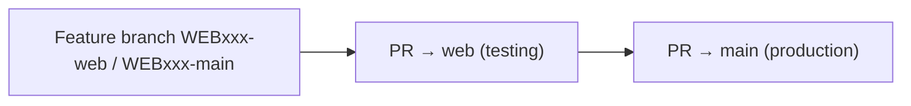

---
covers:
    [
        'package.json',
        'package-lock.json',
        '.env.example',
        'next.config.mjs',
        '.husky/**',
        '.prettierrc.json',
        '.browserslistrc',
        'scripts/**',
    ]
verified_at: 701fd33a
verified_on: 2026-10-22
---

# Development & Verification Guide

Commands below were run on 2026-10-22 against `701fd33a` (Node 25.9.0, npm 11.12.1) unless marked otherwise. The Node minimum, the README version line and the environment-file notes were rechecked at `98fefc31` (2026-10-29). The variable inventory is [CONFIGURATION.md](CONFIGURATION.md).

## Prerequisites & Runtime Environment

- **Node.js:** `>=20.9.0`. That is the `engines.node` value of `next@16.0.7` in `package-lock.json`. The repo has no `.nvmrc`, and `package.json` has no `engines` field. `README.md` states the same minimum (Node.js ≥ 20.9, Next.js 16, React 19).
- **Package Manager:** npm (lockfile: `package-lock.json`). Use `npm ci` for a clean install.
- **Required System Tools:** git. Python 3 only if you run the doc verifier.

## Step-by-Step Setup

1. **Clone & Install:**
    ```bash
    npm ci
    ```
    `npm ci` also runs the `prepare` script (`husky`), which installs the pre-commit hook.
2. **Environment Configuration:**
    ```bash
    cp .env.example .env
    ```
    `next.config.mjs` loads `.env` with `dotenv` (`dotenv.config().parsed`) and uses `process.env` first (`getEnvValue`). `.env.example` is written as `KEY: KEY`. `dotenv` 16.4.5, the version in `package.json`, parses that colon form: copying the file unchanged sets each variable to its own name, which is a placeholder, not an empty value. Replace each placeholder with the value from the team's secret store. Two names that `next.config.mjs` reads are absent from `.env.example`: `ECOMMERCE_WIDGET_TOKEN` and `CHAT_WIDGET_URL` ([OPEN_QUESTIONS.md](OPEN_QUESTIONS.md) Q-020). Never commit `.env` (`.gitignore` lists `.env`, `.env.local`, `.env.prod` and `.env.test`). <!-- verify:ignore -->
3. **Start Development Server:**
    ```bash
    npm run dev
    ```
    Open `http://localhost:3030`. The port is fixed in `package.json` scripts.

> [!WARNING]
> `BASE_URL` must point at a server that is running this app. `src/pages/[[...slug]].js:getStaticProps` fetches `${BASE_URL}/api/data` to load page JSON, so with a wrong `BASE_URL` every page renders empty or fails. Locally use `BASE_URL=http://localhost:3030`.

## Environment Variables Reference

All variables are declared in the `env` block of `next.config.mjs`. Next.js inlines `process.env.X` at build time wherever `X` is referenced, so **any variable referenced from a component ends up in the public JavaScript bundle**. Only variables read solely under `src/pages/api/` stay server-side. Values are never stored in the repo; get them from the team's secret store. [CONFIGURATION.md](CONFIGURATION.md) also lists variables that are declared and not read, plus the Next.js flags that are not environment variables.

Four names are in the `env` block and in `.env.example`, and no file under `src/` reads them: `GOOGLE_CLIENT_ID`, `ZOHO_CLIENT_ID`, `MSAL_CLIENT_ID`, `OTP_WIDGET_TOKEN_LOGIN`. See [OPEN_QUESTIONS.md](OPEN_QUESTIONS.md) Q-009.

| Variable Name                 | Required          | Client-Exposed | Default Value | Description / Where Read                                                                                                                                                        |
| ----------------------------- | ----------------- | -------------- | ------------- | ------------------------------------------------------------------------------------------------------------------------------------------------------------------------------- |
| `BASE_URL`                    | Yes               | Yes            | —             | This site's own origin. Used for `/api/data` fetches, canonical/hreflang URLs and the production `robots` switch (`src/components/HeadComp/HeadComp.js`, `src/utils/getURL.js`) |
| `API_BASE_URL`                | Yes (sign-up)     | Yes            | —             | MSG91 backend for sign-up (`src/components/signupComp/SignUp.js`, `src/components/signupComp/StepThree/StepThree.js`)                                                           |
| `REDIRECT_URL`                | Yes (OAuth)       | Yes            | —             | OAuth redirect base (`src/utils/utilis.js`, `src/pages/github-auth-token.js`, `src/pages/outlook-token.js`)                                                                     |
| `LOGIN_URL`                   | Yes               | Yes            | —             | Dashboard login link (`src/components/notificationBarComp/notificationBarComp.js`, `src/components/ThankYouComp/ThankYouComp.js`)                                               |
| `PRICING_URL`                 | Yes (pricing)     | Yes            | —             | SMS/OTP pricing API (`src/utils/pricing/getSmsOtpPricing.js`)                                                                                                                   |
| `SUBSCRIPTION_PRICING_URL`    | Yes (pricing)     | Yes            | —             | Subscription plan API (`src/utils/pricing/getSubscription.js`, `src/pages/api/pricing/hello.js`)                                                                                |
| `VOICE_API_URL`               | Yes (pricing)     | Yes            | —             | Voice pricing API (`src/utils/pricing/getVoicePricing.js`)                                                                                                                      |
| `HELLO_API_URL`               | Optional          | Yes            | —             | Chatbot templates (`src/utils/getBotTemplates.js`)                                                                                                                              |
| `IMESSAGE_URL`                | Optional          | No             | —             | Apple Messages link API (`src/pages/api/apple-messages/url.js`)                                                                                                                 |
| `GITHUB_CLIENT_ID`            | Yes (OAuth)       | Yes            | —             | GitHub OAuth (`src/utils/utilis.js`)                                                                                                                                            |
| `OTP_WIDGET_TOKEN`            | Yes (sign-up)     | Yes            | —             | MSG91 OTP widget for sign-up (`src/components/signupComp/SignUp.js`)                                                                                                            |
| `WIDGET_AUTH_TOKEN`           | Yes (sign-up)     | Yes            | —             | OTP widget auth token (`src/components/signupComp/SignUp.js`)                                                                                                                   |
| `WIDGET_SCRIPT`               | Yes (sign-up)     | Yes            | —             | OTP widget script URL (`src/utils/otpSigninWidget.js`)                                                                                                                          |
| `SUMMIT_OTP_WIDGET_TOKEN`     | Optional (events) | Yes            | —             | OTP widget for event registration (`src/components/EventRegistrationComp/MobileOtpField.js`)                                                                                    |
| `SUMMIT_WIDGET_AUTH_TOKEN`    | Optional (events) | Yes            | —             | Same file                                                                                                                                                                       |
| `SUMMIT_WIDGET_SCRIPT`        | Optional (events) | Yes            | —             | Same file                                                                                                                                                                       |
| `CHAT_WIDGET_TOKEN`           | Optional          | Yes            | —             | Hello chat widget (`src/components/HeadComp/HeadComp.js`, `src/pages/404.js`)                                                                                                   |
| `ECOMMERCE_WIDGET_TOKEN`      | Optional          | Yes            | —             | Chat widget on the e-commerce page (`src/components/HeadComp/HeadComp.js`)                                                                                                      |
| `CHAT_WIDGET_URL`             | Optional          | Yes            | —             | Chat widget script URL (`src/components/HeadComp/HeadComp.js`, `src/components/ChatBotDemoComp/ChatBotDemoComp.js`)                                                             |
| `WHATSAPP_AUTHKEY`            | Optional (events) | No (secret)    | —             | MSG91 auth key for event WhatsApp messages (`src/pages/api/send-summit-whatsapp.js`). Never reference it outside `src/pages/api/`                                               |
| `SUMMIT_WA_INTEGRATED_NUMBER` | Optional (events) | No             | —             | Same API route                                                                                                                                                                  |
| `SUMMIT_WA_API_URL`           | Optional (events) | No             | —             | Same API route                                                                                                                                                                  |

> [!WARNING]
> Because of the `env` block, referencing `process.env.WHATSAPP_AUTHKEY` (or any future secret) from a component would publish it in the client bundle. Read secrets only inside `src/pages/api/*`.

## Build & Preview Verification

```bash
BASE_URL=http://localhost:3030 npm run build
BASE_URL=http://localhost:3030 npm start
```

The build passes at `701fd33a` and prerenders 285 pages, most of them `/guide/[slug]` blog posts. Pages served by the catch-all `/[[...slug]]` are rendered on first request (`fallback: 'blocking'`), so open them in a browser or with `curl` after `npm start`.

## Running Automated Checks & Tests

| Check Suite              | Command                                        | What It Validates                                                                                                                                                |
| ------------------------ | ---------------------------------------------- | ---------------------------------------------------------------------------------------------------------------------------------------------------------------- |
| Page-data registry check | `node scripts/check-page-data.mjs`             | Every top-level key in every page JSON under `src/data/` names a component registered in `src/pages/[[...slug]].js`                                              |
| Production build         | `BASE_URL=http://localhost:3030 npm run build` | Compiles all pages and prerenders the blog                                                                                                                       |
| Formatting               | `npx prettier --check <files>`                 | `.prettierrc.json` style (4 spaces, single quotes, width 120). The pre-commit hook (`.husky/pre-commit` → `lint-staged`) runs `prettier --write` on staged files |
| Linting                  | `npm run lint`                                 | **Broken at baseline:** Next.js 16 removed `next lint`, so the script fails with "Invalid project directory provided". There is no ESLint config in the repo     |

There is no TypeScript, no unit test runner and no end-to-end suite.

## Safe Test-Data Guidance

- The site has no database. Page content is static JSON in `src/data/`, so local edits there are safe.
- Sign-up, contact, event registration and pricing calls go to real MSG91 services through the URLs above. Don't submit forms against production endpoints with real phone numbers or emails. Use the team's test environment values in `.env`. <!-- verify:ignore -->
- `POST /api/send-summit-whatsapp` sends a real WhatsApp message when `WHATSAPP_AUTHKEY` is set. Leave it unset locally unless you are testing that flow on purpose.

## How an Agent Checks Its Work (Verification Checklist)

1. **Pre-flight:** `npm ci`, then `node scripts/check-page-data.mjs` and `BASE_URL=http://localhost:3030 npm run build`. Both must pass before you change anything.
2. **After the change:**
    - Re-run `node scripts/check-page-data.mjs` and the build.
    - If you added or renamed a section component, register it in the `Components` map in `src/pages/[[...slug]].js` and use the same key in the JSON.
3. **Browser check:** `BASE_URL=http://localhost:3030 npm start`, then open each affected page for every country folder that has it (for example `/whatsapp`, `/in/whatsapp`, `/br-pt/whatsapp`). Check the browser console: an unregistered key logs `Component "<key>" is undefined`. Check mobile (375px) and desktop (1280px) widths.
4. **SEO check:** for a URL change, add a redirect in `public/_redirects` and check `public/sitemap.xml`. Title and description come from the page's `HeadComp` JSON block (see [DESIGN.md](DESIGN.md)).
5. **Docs:** if routes, components, JSON shapes, env vars or API calls changed, update the owning doc in `docs/` in the same PR. Then run `python3 <create-ai-docs skill>/scripts/verify_docs.py .`, a script from the create-ai-docs skill, not from this repo.

## PR Workflow & Deployment Pipeline

Confirmed by the user, 2026-10-22: changes move from a feature branch to `web` (testing) to `main` (production, msg91.com).



### Flow Steps

1. **Branch Creation:** Each ticket gets **two** branches, one per target: `WEBxxx-web` is merged into `web`, and `WEBxxx-main` is merged into `main`. For example, `WEB023-web` became PRs #1346 and #1351 into `web`, and `WEB023-main` became PR #1338 into `main`. `sync-web` and `sync-main` branches carry merges between the two.
2. **Pre-PR Self-Verification:** Complete the checklist above. Make sure `git status` has no stray files.
3. **Pull Request Submission:** Open the `-web` PR into `web` first. Once it has been tested there, open the `-main` PR into `main`. Merges happen through GitHub PRs (`Merge pull request #NNNN` in history).
4. **Testing (`web`) and Production (`main`):**

> [!TODO]
> Not determinable from the repository: there is no CI workflow (`.github/` is absent) and no hosting config apart from `public/_headers` and `public/_redirects`, which suggest a Netlify/Cloudflare-Pages-style host. Which host deploys `web` and `main`, and whether deploys are automatic, needs a human. <!-- verify:ignore -->
