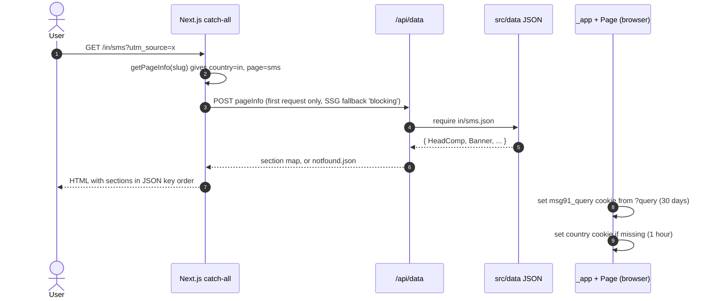
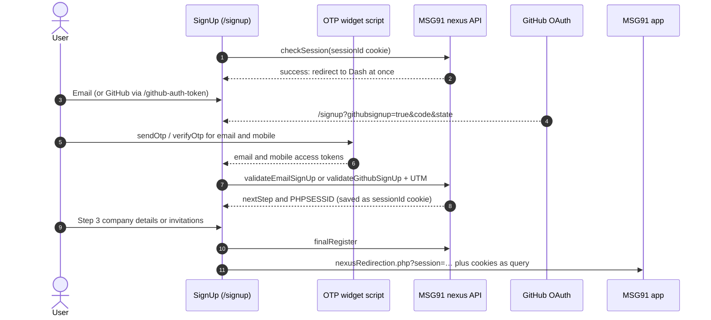
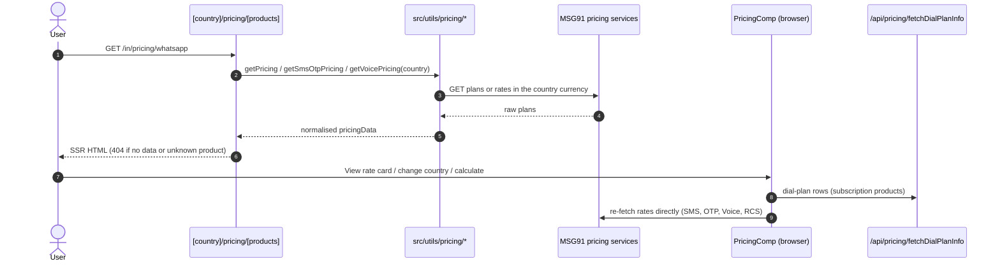
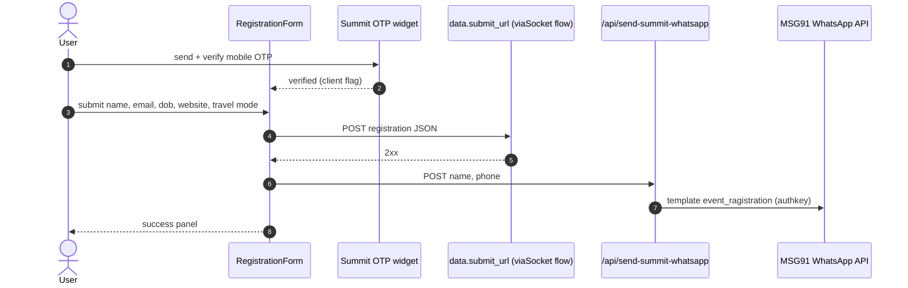

---
covers:
    [
        'src/components/signupComp/**',
        'src/components/PricingComp/**',
        'src/components/ContactUs/**',
        'src/components/EventRegistrationComp/**',
        'src/pages/**',
        'src/utils/otpSigninWidget.js',
        'src/utils/setCookies.js',
        'src/utils/generateWidgetScript.js',
    ]
verified_at: 701fd33a
verified_on: 2026-10-22
---

# User Flows & Critical Journeys

The site has one goal: turn a visitor on a country-localized page into an MSG91 sign-up (see [VISION.md](VISION.md)). The five journeys below carry that goal. Each one starts on a public page with no login. Every write goes either to MSG91 backends outside this repo or to one of the small proxy routes in `src/pages/api/`. Request and response shapes for every endpoint named here live in [CONTRACTS.md](CONTRACTS.md). How the page registry and data folders work is in [ARCHITECTURE.md](ARCHITECTURE.md).

## Core User Journeys Map

| Flow Name                           | Trigger / Starting Route                                                                               | Target Outcome                                                                     | Primary Route & Component                                                                                                                                               |
| ----------------------------------- | ------------------------------------------------------------------------------------------------------ | ---------------------------------------------------------------------------------- | ----------------------------------------------------------------------------------------------------------------------------------------------------------------------- |
| 1. Land on a localized page         | Any URL, e.g. `/`, `/in/sms`, `/ae/whatsapp`                                                           | Country-specific page rendered; `country` and `msg91_query` cookies set            | `src/components/PageRenderer/PageRenderer.js:PageRenderer`                                                                                                              |
| 2. Sign up                          | `/signup` (all "Sign up" CTAs go here via `src/utils/getURL.js:getURL`)                                | Account created; browser sent to the MSG91 app with a session                      | `src/components/signupComp/SignUp.js:SignUp`                                                                                                                            |
| 3. Check pricing                    | `/pricing/<product>`, `/<country>/pricing/<product>`                                                   | Plans, rate cards and calculators shown in the country's currency                  | `src/pages/[country]/pricing/[products].js:getServerSideProps` → `src/components/PricingComp/index.js:PricingComp`                                                      |
| 4. Contact or register for an event | `/contact-us`, `/<country>/contact-us`, `/event-registration`                                          | Sales or support reached; event registration stored and WhatsApp confirmation sent | `src/components/ContactUs/index.js:ContactUsComp`, `src/components/EventRegistrationComp/RegistrationForm.js:RegistrationForm`                                          |
| 5. Use a free tool                  | `/free-whatsapp-link-generator`, `/free-apple-messages-for-business-link-generator` (also per country) | Link, QR code and embeddable widget snippet generated                              | `src/components/WhatsappLinkComp/WhatsappLinkComp.js:WhatsappLinkComp`, `src/components/AppleMessagesLinkComp/AppleMessagesLinkComp.js:MSG91AppleMessagesLinkGenerator` |

Admin journeys (private, operator-only) are at the end: [visitor in an experiment](#detailed-journey-visitor-in-an-experiment), [edit knowledge](#detailed-journey-operator-edits-knowledge), [run an experiment](#detailed-journey-operator-runs-an-experiment) and [analyses](#detailed-journey-analyses-and-research-runs).

Not covered here: the `/guide` blog, the startup application form (`src/components/StartupFormsComp/`), the chatbot demo (`src/pages/demochatbot.js`) and the voice-extension login page (`src/pages/verify.js`).

---

## Detailed Journey: Visitor lands on a localized page

### 1. Happy Path Sequence

### 2. Step-by-Step Path & Code Connections

1. **User Action & Route:**
    - URL: any path not claimed by a more specific page. `/<country>/pricing/<product>`, `/pricing/<product>`, `/guide/*`, `/github-auth-token`, `/outlook-token`, `/verify` and `/demochatbot` have their own files under `src/pages/`.
    - Entry component: `src/components/PageRenderer/PageRenderer.js:PageRenderer`.
    - Trigger: navigation. `src/pages/[[...slug]].js:getStaticPaths` returns no paths and `fallback: 'blocking'`, so each URL is rendered on its first request and then served from cache. `getStaticProps` sets no `revalidate`, so a page only changes on the next deploy.
2. **State & Validation:**
    - `src/utils/getPageInfo.js:getPageInfo` reads the country from the URL only. The first segment is a country if it matches a `shortname` in `src/data/availableCountries.json`. Otherwise the country is `global`. The IP address and the `Accept-Language` header are not used.
    - `src/utils/getCommonCompData.js` loads the header, menu and footer data for that country.
3. **API Dispatch:**
    - `getStaticProps` POSTs `pageInfo` to its own `POST /api/data` (`src/pages/api/data.js`), using `BASE_URL`. See [CONTRACTS.md](CONTRACTS.md).
    - Brazilian Hello pages (`br`, `br-pt`) also call `src/utils/pricing/getPricing.js` inside `getStaticProps` (on the first request after a deploy, since nothing is prerendered) and pass the rows in as `Pricing.initialPricingData`.
4. **Response & Persistence:**
    - `Page` renders the menu bar, then each top-level JSON key through the `Components` map, then the footer.
    - Cookies (client side only):
        - `src/utils/setCookies.js:handleBrawserCookies` runs in `src/pages/_app.js` on every page. It copies `window.location.search` into the `msg91_query` cookie for 30 days. On `partners-and-integrations/<plugin>` pages that have no query string, it writes `utm_campaign=tigerplugin&utm_source=<plugin>` instead.
        - `Page` writes `country=<pageInfo.country>` with `max-age=3600` if the cookie is missing. Picking a language in `src/components/notificationBarComp/notificationBarComp.js:NotificationBarComp` overwrites it.

### 3. Alternative Paths & Conditional Branches

- **Branch A (no JSON file, or the file has `common` or `show: false`):** `src/pages/api/data.js` returns `src/data/notfound.json`. `getStaticProps` sees `NotFoundComp` and returns `notFound: true`, so the visitor gets `src/pages/404.js`.
- **Branch B (country switch):** the country and language menus in `NotificationBarComp` build the target URL with `src/utils/getURL.js:getURL('country', …)`. If the target country has no JSON for this page, the visitor is sent to that country's home page instead.
- **Branch C (Hello page in `br`/`br-pt`):** `Page` swaps `Banner` and `Features` for the Brazil-specific components.

### 4. Permissions, Roles & Guard Rails

- **Required Role / Permission:** none. Every page is public. The repo has no Next.js middleware file, no route guards and no session check outside the sign-up flow.
- **Enforcement Location:** not applicable.
- **Unauthorized Behavior:** not applicable. A missing page is the only "denied" state, and it renders the 404 page.

> [!WARNING]
> Nothing in this repo reads the `country` cookie. It is written in two places with a one-hour lifetime, but no code here redirects on it. If you expect visitors to be sent to their country automatically, that happens outside this repo, if anywhere. Also note that `src/utils/utilis.js:setUtm` rewrites links with class `utm`, but no component at `701fd33a` uses that class.

> [!WARNING]
> Pages are cached forever after their first render. A broken `/api/data` response on that first request (for example, a wrong `BASE_URL` in the deploy environment) is cached for the whole life of the deploy.

### 5. Failure Modes & Recovery Paths

| Failure Scenario                                             | Where Caught                                               | UI Feedback                                | Recovery / Fallback Action                                                         |
| ------------------------------------------------------------ | ---------------------------------------------------------- | ------------------------------------------ | ---------------------------------------------------------------------------------- |
| Unknown page or country                                      | `src/pages/api/data.js:handler` (`require` throws)         | 404 page                                   | None. Add the JSON file under `src/data/<country>/`                                |
| JSON key with no registered component                        | `src/components/PageRenderer/PageRenderer.js:PageRenderer` | Section silently missing; `console.error`  | Register the component in `Components`                                             |
| Hello BR pricing fetch fails during first-request generation | `getStaticProps` `try/catch`                               | Pricing section falls back to client fetch | `src/components/HelloBrComp/PricingComp/Pricing.js` calls `GET /api/pricing/hello` |
| Cookie write blocked                                         | Not handled                                                | None                                       | Sign-up UTM attribution is lost                                                    |

---

## Detailed Journey: Sign-up

### 1. Happy Path Sequence

### 2. Step-by-Step Path & Code Connections

1. **User Action & Route:**
    - URL: `/signup`, served by the catch-all from `src/data/global/signup.json`, whose keys are `HeadComp` and `SignUp`. There is no per-country sign-up page. `/in/signup` returns 404.
    - Entry component: `src/components/signupComp/SignUp.js:SignUp`, a class component. Its state lives in `this.state` and nothing is shared.
    - Trigger: in `src/components/signupComp/StepOne/StepOne.js:StepOne`, the user clicks "Sign up with Email" (`setStep(2)`) or the GitHub button (`src/utils/utilis.js:loginWithGitHubAccount`).
2. **State & Validation:**
    - On mount, `SignUp` does four things:
        - Appends the `msg91_query` cookie to the module-level `SUCCESS_REDIRECTION_URL`.
        - Injects the OTP widget script (`otpWidgetSetup`, which uses `WIDGET_SCRIPT`, `OTP_WIDGET_TOKEN` and `WIDGET_AUTH_TOKEN`).
        - Copies every URL query parameter into a cookie shared across `.msg91.com` (`src/utils/utilis.js:setSharedCookie`, 1 day).
        - Calls `checkSession`. If a session already exists, the user is redirected straight to the app.
    - Step 2 is `src/components/signupComp/StepTwo/StepTwo.js:StepTwo`:
        - The email must match `EMAIL_REGEX` and the mobile number `MOBILE_REGEX`, both exported from `SignUp.js`.
        - A `@gmail.com` address opens `src/components/signupComp/utils/GmailWarningModal.js:GmailWarningModal` before the OTP is sent.
        - The "How did you hear about us" source picker writes `source` back into the URL and into `msg91_query`.
        - Submit stays disabled until a source is chosen and both identifiers are verified.
    - OTP calls go to globals the widget script defines: `window.sendOtp`, `window.verifyOtp` and `window.retryOtp`. Retry channels come from `window.getWidgetData()`, polled every second until the script loads.
    - Step 3 is `src/components/signupComp/StepThree/StepThree.js:StepThree`. It loads countries, services, industries, states and cities from `API_BASE_URL/api/v5/web/*`. When creating a company, every field is required, and GST and pincode are validated. On submit it writes the shared `signup_date` cookie (30 days).
3. **API Dispatch** (all `fetch` POSTs to `API_BASE_URL`; payloads in [CONTRACTS.md](CONTRACTS.md)):
    - `/api/v5/nexus/checkSession` from `SignUp.componentDidMount`. <!-- verify:ignore -->
    - `/api/v5/nexus/validateEmailSignUp` or `/api/v5/nexus/validateGithubSignUp` from `SignUp.validateUserForCompany`. All key/value pairs in `msg91_query` are spread into the body. <!-- verify:ignore -->
    - `/api/v5/nexus/finalRegister` from `SignUp.finalSubmit`. <!-- verify:ignore -->
4. **Response & Persistence:**
    - `SignUp.setSession` stores `PHPSESSID` from any response as the `sessionId` cookie (30 days).
    - On success, the browser goes to `API_BASE_URL/api/nexusRedirection.php?session=<PHPSESSID>` with `msg91_query`, `signup_date`, `interested_services` and every readable cookie appended as query parameters (`src/utils/utilis.js:getUtmFromCookies`). <!-- verify:ignore -->

### 3. Alternative Paths & Conditional Branches

- **Branch A (existing session):** `checkSession` returns `success`, so the user is redirected to the app without seeing the form.
- **Branch B (GitHub):**
    - `loginWithGitHubAccount(false)` sends the user to GitHub with `redirect_uri=REDIRECT_URL/github-auth-token?githubsignup=true`.
    - `src/pages/github-auth-token.js` forwards all query parameters to `REDIRECT_URL/signup`.
    - `SignUp` sees `code` and opens at step 2 with email verification skipped. It calls `validateGithubSignUp` with `code` and `state`. If that fails, it shows a toast and resets to step 1.
- **Branch C (`validate*` returns `nextStep`):**
    - `createNewCompany` or `createNewCompanyFromSignup`: go to step 3.
    - `hasInvitations`: go to step 3 with an invitation list. The user must accept at least one invitation or create a company.
    - `loginIntoExistingAccount`: redirect straight to the app.
- **Branch D (`?service=<x>` on the URL):** pre-selects that service in step 3.
- **Branch E (Outlook):** `src/pages/outlook-token.js` forwards its query parameters to `REDIRECT_URL/signin?loginWithOutlook=true`. That is a login callback, not a sign-up, and `/signin` is not a route in this repo.

> [!TODO]
> Google, Zoho and Microsoft sign-up are not wired on this site. `src/components/signupComp/utils/GoogleLogin.js` is never imported. `ZOHO_CLIENT_ID` and `MSAL_CLIENT_ID` are exposed in `next.config.mjs` but no code here reads them. `src/utils/otpSigninWidget.js` is also not imported anywhere. They are used on the `web` branch alongside a new `SignupCompNew` sign-up flow, so they were kept. See [OPEN_QUESTIONS.md](OPEN_QUESTIONS.md) Q-009. <!-- verify:ignore -->

### 4. Permissions, Roles & Guard Rails

- **Required Role / Permission:** none to start. A user must verify a mobile number plus either an email or GitHub before `validate*` is called (`SignUp.validateUserForCompany` shows the toast "Email and Mobile should be verified.").
- **Enforcement Location:** only on the client, in `StepTwo` and `SignUp`. Verification really happens on the backend, through the widget access tokens.
- **Unauthorized Behavior:** backend errors arrive as `hasError` and `errors`, and are shown with `react-toastify`.

> [!WARNING]
> `SUCCESS_REDIRECTION_URL` is a module-level `let`, and `componentDidMount` appends to it with `+=`. If `SignUp` mounts twice in one page session (client-side navigation back to `/signup`), the query is appended twice. Build the URL inside the method instead of editing the module variable.

> [!WARNING]
> `getUtmFromCookies` returns every non-HttpOnly cookie, not just UTM values. The success redirect therefore carries `sessionId`, `country`, `msg91_query` and any analytics cookies in its query string. Filter the cookies before adding new ones to the redirect.

> [!WARNING]
> `StepThree` sends a hard-coded `Cookie` header on its lookup requests. Browsers refuse to set `Cookie` on XHR, so the header does nothing. Do not copy this pattern, and do not treat those values as configuration.

### 5. Failure Modes & Recovery Paths

| Failure Scenario                                 | Where Caught                                        | UI Feedback                                                                                                                             | Recovery / Fallback Action                                                                  |
| ------------------------------------------------ | --------------------------------------------------- | --------------------------------------------------------------------------------------------------------------------------------------- | ------------------------------------------------------------------------------------------- |
| Invalid email or mobile format                   | `SignUp.sendOtp`                                    | Toast "Invalid email address." or "Invalid mobile number."                                                                              | User edits the field                                                                        |
| OTP send or verify rejected                      | Widget failure callbacks in `sendOtp` / `verifyOtp` | Toast with the widget message                                                                                                           | User retries. Code `704` (retries exhausted) hides the retry links                          |
| OTP widget script fails to load                  | Not handled (`otpWidgetSetup` has no `onerror`)     | Clicking Send throws, because `window.sendOtp` is undefined, after `isLoading` is already set, so the buttons stay in the loading state | Reload the page                                                                             |
| `validate*` / `finalRegister` returns `hasError` | `.then` in `SignUp`                                 | Toast with `errors[0]`                                                                                                                  | Verified tokens are cleared, so the user must verify again. GitHub sign-ups reset to step 1 |
| Network error on `validate*` / `finalRegister`   | `.catch` in `SignUp`                                | None (only `console.error`)                                                                                                             | Loading stops and tokens are cleared, so the user must verify again                         |
| `checkSession` fails                             | Not handled                                         | None                                                                                                                                    | Form renders normally                                                                       |

---

## Detailed Journey: Pricing

### 1. Happy Path Sequence

### 2. Step-by-Step Path & Code Connections

1. **User Action & Route:**
    - URLs:
        - `/<country>/pricing/<product>` is handled by `src/pages/[country]/pricing/[products].js`.
        - `/pricing/<product>` is handled by `src/pages/pricing/[products].js`. It fetches prices as `us` but labels the page `global`.
        - `/pricing` is a host-level redirect to `/pricing/hello` (`public/_redirects`).
    - Both route files use `getServerSideProps`, so prices are fetched on every request and never cached at build time.
    - Valid products are the `slug`s under `products.applications` and `products.channels` in `src/data/<country>/pricing.json`: `hello`, `campaign`, `segmento`, `otpwidget`, `sms`, `otp`, `email`, `whatsapp`, `voice` and `rcs` in `global`.
2. **State & Validation:**
    - `src/utils/pricing/getCurrencySymbol.js:GetCurrencySymbol` maps the URL country to its currency through `src/data/countries.json`. Unknown countries fall back to USD.
    - The URL is the only currency input; there is no currency picker on the subscription pages.
3. **API Dispatch** (shapes in [CONTRACTS.md](CONTRACTS.md)):
    - Subscription products (`hello`, `segmento`, `email`, `rcs`, `whatsapp`, `otpwidget`): `src/utils/pricing/getPricing.js` calls `SUBSCRIPTION_PRICING_URL/plans` with the product's `ms_id`. The result is normalised by `src/utils/pricing/handlePlanStructure.js`.
    - `sms` and `otp`: `src/utils/pricing/getSmsOtpPricing.js` calls `PRICING_URL/api/v5/web/fetchPricingDetails` once per amount tier. India in INR has 7 tiers; every other country has one tier of 5000.
    - `voice`: `src/utils/pricing/getVoicePricing.js` calls three `VOICE_API_URL/public/*` endpoints: country, then dial plan, then pricing.
    - `campaign`: no fetch (`getPricing` returns `{}`). Static content only.
4. **Response & Persistence:**
    - `src/components/PricingComp/index.js:PricingComp` picks the view by `pageInfo.product`:
        - `PricingSubscription` shows plan cards, compare-plans, the dial-plan table, a calculator modal and FAQs.
        - `PricingSMSOTP` serves both `sms` and `otp`.
        - `PricingVoice` serves `voice`.
        - `PricingCampaign` serves `campaign`.
    - Nothing is persisted. Plan-card CTAs link to `/signup` (flow 2).

### 3. Alternative Paths & Conditional Branches

- **Branch A (View rate card):** `src/components/PricingComp/DialPlan/index.js:DialPlan` (client-only) pages and searches rows through `GET /api/pricing/fetchDialPlanInfo` (`src/pages/api/pricing/fetchDialPlanInfo.js`). That route proxies to `SUBSCRIPTION_PRICING_URL/fetchDialPlanInfo`.
- **Branch B (change origin or destination country on SMS/OTP):** `src/components/PricingComp/PricingSMS/PricingSMSOTP.js:GetSmsOtpPricing` calls `PRICING_URL` straight from the browser. The currency stays the page currency.
- **Branch C (change country on Voice, or Export):** `src/components/PricingComp/PricingVoice/PricingVoice.js:PricingVoice` calls `VOICE_API_URL` from the browser. Export follows the returned file URL with `window.location.href`.
- **Branch D (Hello pricing embedded in product pages):**
    - `src/components/NewHelloComp/NewHelloPricingComp/NewHelloPricingComp.js:PricingHello` (rendered by `NewHelloComp`) fetches `ms_id` 7 on the client via `src/utils/pricing/getSubscription.js`.
    - The Brazil Hello page instead uses `GET /api/pricing/hello`. That route falls back from BRL to USD and always returns HTTP 200.
- **Branch E (mobile product switcher):** `src/components/PricingComp/PricingNavComp/PricingNavComp.js:PricingNav` navigates to `/pricing/<slug>`.

> [!WARNING]
> The mobile `<select>` in `PricingNav` hard-codes `/pricing/${slug}` and drops the country, so an Indian visitor on mobile who switches product lands on the USD/global page. The desktop tabs use `getURL('pricing', …)` and keep the country.

> [!WARNING]
> In `src/pages/[country]/pricing/[products].js`, `getPricingPageData` and `getProducts` call `require('@/data/${country}/pricing.json')` without a `try`. Any `/<not-a-country>/pricing/<x>` URL matches this route and throws, which returns a 500 instead of a 404. In `src/pages/api/pricing/fetchDialPlanInfo.js`, the catch block reads `err.response.status`, which also throws on network errors where there is no `response`.

### 4. Permissions, Roles & Guard Rails

- **Required Role / Permission:** none. All pricing endpoints are called without auth from both server and browser. Every pricing base URL is put into the client bundle by `next.config.mjs` (see [DEVELOPMENT.md](DEVELOPMENT.md)).
- **Enforcement Location:** not applicable.
- **Unauthorized Behavior:** not applicable.

### 5. Failure Modes & Recovery Paths

| Failure Scenario                                    | Where Caught                                        | UI Feedback                                                                                                                                                  | Recovery / Fallback Action                             |
| --------------------------------------------------- | --------------------------------------------------- | ------------------------------------------------------------------------------------------------------------------------------------------------------------ | ------------------------------------------------------ |
| Unknown product slug, or SSR fetch returned nothing | `getServerSideProps` (`isProduct` / `!pricingData`) | 404                                                                                                                                                          | None                                                   |
| Subscription or voice API throws during SSR         | `try/catch` in `getServerSideProps`                 | 404 (because `pricingData` is undefined)                                                                                                                     | Reload. Nothing is cached, so the next request retries |
| SMS/OTP API fails during SSR                        | `src/utils/pricing/getSmsOtpPricing.js` `catch`     | Page renders; client fetches on mount                                                                                                                        | `PricingSMSOTP` retries from the browser               |
| Dial-plan fetch fails                               | `DialPlan` `.catch`                                 | Toast with the API message                                                                                                                                   | User changes the search, page or plan                  |
| Voice API not ok                                    | `PricingVoice.loadDataForCountry` (`setError`)      | The `error` state is never rendered. The table shows "No pricing data available for this country." if no plans loaded, or keeps the previous country's plans | User picks another country                             |
| Hello BRL plans missing                             | `src/pages/api/pricing/hello.js:handler`            | Prices shown in USD                                                                                                                                          | Automatic USD fallback                                 |

---

## Detailed Journey: Contact us and event registration

### 1. Happy Path Sequence

### 2. Step-by-Step Path & Code Connections

1. **User Action & Route:**
    - **Contact us** (`/contact-us` and each country's version) is rendered by `src/components/ContactUs/index.js:ContactUsComp`. There is no form to submit:
        - The sales and support cards in `src/components/ContactUs/ContactCard.js:ContactCard` are `mailto:`, `wa.me` and `tel:` links.
        - "Book a slot" opens `src/components/ContactUs/BookingModal.js:BookingModal`, which mounts the MSG91 chat widget (`blacksea.msg91.com/chat-widget.js`) full-screen using the card's `widgetToken`. <!-- verify:ignore -->
        - On `in` pages only, an RCS QR card is also shown.
    - **Event registration** (`/event-registration`, from `src/data/global/event-registration.json`) is rendered by `src/components/EventRegistrationComp/index.js`, which contains `RegistrationForm`.
2. **State & Validation:**
    - `RegistrationForm` keeps the form in local `useState`. Fields, labels and error strings all come from the JSON.
    - The mobile field is `src/components/EventRegistrationComp/MobileOtpField.js:MobileOtpField`. It uses `intl-tel-input` and the summit OTP widget (`SUMMIT_WIDGET_SCRIPT`, `SUMMIT_OTP_WIDGET_TOKEN`, `SUMMIT_WIDGET_AUTH_TOKEN`).
    - Fields after the mobile field stay locked until the mobile number is verified. The email and website checks reuse `EMAIL_REGEX` and `WEBSITE_REGEX` from `SignUp.js`.
3. **API Dispatch:**
    - POST to `form.submit_url` from the JSON (a `flow.sokt.io` endpoint).
    - Then `POST /api/send-summit-whatsapp` (`src/pages/api/send-summit-whatsapp.js`), which calls `SUMMIT_WA_API_URL` with the `WHATSAPP_AUTHKEY` header.
4. **Response & Persistence:**
    - On success, the form resets and the success panel is shown. Nothing is stored in the browser.

### 3. Alternative Paths & Conditional Branches

- **Branch A (no `submit_url` in the JSON):** the form shows success without sending anything.
- **Branch B (WhatsApp send fails):** the error is logged only. The user still sees success, because the registration itself was saved.

### 4. Permissions, Roles & Guard Rails

- **Required Role / Permission:** none. The mobile OTP check is enforced only in the browser.

> [!WARNING]
> `POST /api/send-summit-whatsapp` has no auth, no rate limit and no OTP-token check. Anyone can call it with any `name` and `phone` and send the MSG91 template from the summit number. If you touch this route, check the widget verification token on the server or restrict the origin.

### 5. Failure Modes & Recovery Paths

| Failure Scenario                               | Where Caught                                 | UI Feedback                     | Recovery / Fallback Action              |
| ---------------------------------------------- | -------------------------------------------- | ------------------------------- | --------------------------------------- |
| Required field empty, bad email or bad website | `RegistrationForm.handleSubmit`              | Toast using `data.errors.*`     | User fixes the field                    |
| Mobile not verified                            | `handleSubmit`                               | Toast `otp.errors.not_verified` | User verifies the OTP                   |
| Summit widget env vars missing                 | `MobileOtpField`                             | Toast `errors.widget`           | None. Fix the deploy env                |
| `submit_url` not ok                            | `handleSubmit` `catch`                       | Toast `errors.submit`           | User resubmits; values are kept         |
| WhatsApp API down or credentials missing       | `send-summit-whatsapp` (500) / `try` in form | None                            | Registration still counts as successful |
| Chat widget script not loaded                  | `BookingModal` effect guard                  | Empty modal                     | User closes and retries                 |

---

## Detailed Journey: Free tools (WhatsApp and Apple Messages link generators)

### 1. Happy Path Sequence

Both tools follow the same steps: form, then link, then QR code, then a widget snippet the user copies onto their own site. Only the Apple tool calls a server.

1. **WhatsApp link** (`WhatsappLinkComp`):
    - Builds `https://wa.me/<phone>?text=<message>` entirely in the browser. <!-- verify:ignore -->
    - Draws the QR code with `public/js/qrcode.js`.
    - Builds the snippet with `src/utils/generateWidgetScript.js:generateWidgetScript('whatsapp', …)`. The snippet loads `public/js/waWidget.js` from `BASE_URL`.
2. **Apple Messages link** (`MSG91AppleMessagesLinkGenerator`):
    - Validates the fields inline.
    - POSTs `businessId`, `intentId`, `groupId` and `preFilledMessage` to `POST /api/apple-messages/url` (`src/pages/api/apple-messages/url.js`), which proxies to `IMESSAGE_URL`.
    - On `{ success, url }` it shows the link, QR code and an `apple` snippet that loads `public/js/appleMessagesWidget.js`.

### 2. Permissions & Failure Modes

- No auth on either tool.
- WhatsApp with an empty phone number: a browser `alert` stops generation.
- Apple Messages: the route returns HTTP 200 with `{ success: false, message }` for every upstream error (timeout, 4xx, 5xx). Only an axios-level failure in the browser produces the generic "Network error" toast.

> [!WARNING]
> `generateWidgetScript` puts user-typed strings into the snippet inside JavaScript template literals (`` ` ``) without escaping. A backtick or `${` in the welcome text or message breaks the generated code, or runs as JavaScript on the site where the user pastes it. Escape the strings before adding new fields.

---

## Detailed Journey: Visitor in an experiment

1. A visitor requests a URL that has a running experiment. `src/proxy.js` reads the live config (cached 5 s), creates `msg91_vid` if missing, picks the arm deterministically and rewrites to `/exp-view/<id>/<arm>/<path>`. The address bar does not change.
2. `src/pages/exp-view/[id]/[arm]/[[...slug]].js` loads the same props as the catch-all (`loadPageProps`), applies the arm's overrides and renders `PageRenderer` with `Cache-Control: private, no-store`. If the experiment stopped in the last few seconds, it renders the baseline.
3. After hydration, `ExperimentExposure` sends an exposure beacon and pushes `experiment_exposure` to `dataLayer`.
4. If the visitor signs up, `SignUp` sends `signup_started`, `signup_verified` and `signup_completed` outcome beacons (only when `msg91_exp_on=1`). The event API attributes them to the versions listed in `msg91_exp`.

| Failure                                                       | Behaviour                                                               |
| ------------------------------------------------------------- | ----------------------------------------------------------------------- |
| Admin store unreadable                                        | `getLiveConfig` logs and routes nobody: everyone gets the normal page   |
| Beacon blocked (extensions, no JS)                            | Visitor is not counted as exposed; the page still works                 |
| Experiment paused or stopped                                  | Proxy stops routing within ~5 s; in-flight rewrites render the baseline |
| Event with the wrong arm, unknown experiment or stale version | Rejected (`202` with `accepted: false` and a reason)                    |

## Detailed Journey: Operator edits knowledge

1. `/admin/knowledge` lists every doc with status, owner, verification date and open changes (it also re-checks pending changes). `/admin/knowledge/<id>` shows the rendered effective revision, its source and revision SHA.
2. **Edit** → _Save draft_ stores a proposed change with the base blob SHA. A second operator saving the same draft with an older `updatedAt` gets a 409 (`stale_draft`).
3. _Submit for review_ (`POST /api/admin/knowledge/changes/<id>` `submit`):
    - file changed since the base → status **conflict**; _Rebase on current_ moves the draft onto the new revision for another review;
    - another change to the same doc pending → 409 `pending_exists`;
    - `local` mode → file written to the working tree, status **pending** ("commit and open a PR");
    - `github` mode → branch `admin/<doc>-<id>` + commit + PR into `GITHUB_WRITEBACK_BASE`, status **pending** with the PR link;
    - any repository error → **sync_failed** with the message; _Retry submit_ is offered. A failed save is never shown as effective.
4. **Effective** when the PR is merged (GitHub) or the change is committed (local). Only then do agents read it, because they read the repository. Closed PRs become **rejected**; a working tree that no longer holds the change becomes **superseded**.
5. **History** lists commits for the file; _Restore as draft_ starts a new draft from an old revision (it goes through review like any change).

## Detailed Journey: Operator runs an experiment

1. `/admin/experiments` → _Create draft_ with a name and a JSON-driven URL (pricing routes are refused).
2. On the experiment page: fill the plan (hypothesis, metrics, baseline rate, MDE, review date, approver, rollback), edit arms (name, weight, overrides JSON) and preview each arm at `<url>?exp_preview=<id>:<arm>` (admin session required, never tracked).
3. _Validate tracking_ sends synthetic exposure + outcome events per arm through `/api/exp/event` and checks they are recorded as synthetic. Any material edit clears the validation.
4. _Launch_ (owner, release switch on, checklist complete). Results show collecting / insufficient data / inconclusive / better / worse / harmful / invalid per [EXPERIMENTS.md](EXPERIMENTS.md).
5. _Pause_ (editor+) for safety; _Stop & keep baseline_, _Promote_ (opens a page-JSON PR and routes everyone to the arm) and _Retire_ (owner). Material changes after launch require a confirmed new version.
6. Extra challenger ideas use _Propose challenger_: placed as an arm if a slot is free before launch, otherwise queued.

## Detailed Journey: Analyses and research runs

- **Scheduled:** an external cron calls `POST /api/admin/cron/tick` (`Authorization: Bearer $CRON_SECRET`), or `ADMIN_SCHEDULER=inprocess` runs `tick()` every `ADMIN_SCHEDULER_MINUTES`. Each due analysis claims a run with a slot dedupe key; overlapping ticks skip it.
- **Event-triggered:** `?event=deploy` (post-deploy checks), experiment launch (experiment health), knowledge change effective (freshness).
- **Manual:** _Run now_ on `/admin/analyses`; _Check due sources now_ on `/admin/research`.
- **Failure:** the run is stored as failed with the error and a retry time (5 min × 2^attempt, up to `maxRetries`). Budgets exhausted → `budget_exhausted`, resumable next day or after raising the budget. Pause switches stop scheduled runs but not manual ones.
